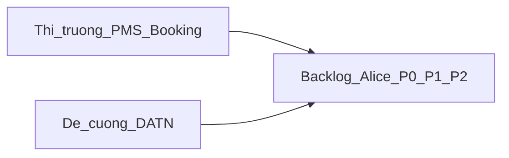
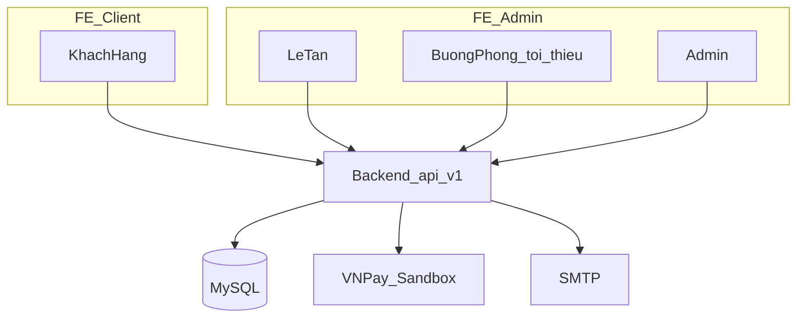

# Alice Hotel — FEATURES

> Nguồn: đề cương DATN + khảo sát PMS thị trường. Theo dõi trạng thái triển khai trong repo.

**Triển khai code (2026-10):** schema `alice_hotel_booking_schema.sql`; API `/c/booking/**` + `/a/**` (master, front desk, dashboard, Excel, shift, review, VNPay sandbox, hold expire job); FE admin (Front Desk, Dashboard, master CRUD); FE client (tim phong, dat phong, lich su, dang ky, VNPay return). Chay SQL booking sau `alice_hotel_init.sql`.

# Plan tính năng — Website đặt phòng khách sạn Alice (chi tiết + khảo sát thị trường)

Nguồn gốc: đề cương [5250019_LaiVanChien_CNTT_K29.1.docx](5250019_LaiVanChien_CNTT_K29.1.docx). Stack giữ theo repo + [STANDARDS.md](STANDARDS.md) (session auth, Vuetify, Gradle) — không đổi JWT/Bootstrap/Maven chỉ vì đề cương.

Repo: shell RBAC + booking domain P0/P1 (schema + API + FE admin/client). Chạy `alice_hotel_booking_schema.sql` trước khi demo.

---

## 1. Khảo sát phần mềm đang dùng trên thị trường

### 1.1 PMS quốc tế (Cloudbeds, Mews, OPERA Cloud, Priority Optima — 2025/2026)

Các module “must-have” lặp lại trên tài liệu buyer guide / feature list:

| Nhóm | Tính năng thị trường thường có |
|------|--------------------------------|
| Inventory & reservation | Loại phòng, rate plan/package, availability realtime, group booking, overbooking control |
| Channel / distribution | Channel manager đồng bộ OTA (Booking, Expedia…) — **ngoài phạm vi đề cương Alice** |
| Booking engine | Widget đặt trực tiếp trên website KS, mobile-first, giá total minh bạch, extras/upsell |
| Front desk | Check-in/out, gán/đổi phòng (room move), folio/billing, giấy tờ khách |
| Guest CRM | Hồ sơ khách, lịch sử lưu trú, preference, pre/post-stay messaging |
| Housekeeping | Trạng thái sạch/bẩn/đang dọn, task dọn theo checkout, bảo trì |
| Payments | Cọc/prepay, nhiều phương thức, đối soát, thuế/phí |
| Analytics | Occupancy, ADR, RevPAR, doanh thu theo nguồn/ngày |
| Ops nâng cao | Loyalty, POS F&B gắn folio, spa/event, mobile key, open API |

Nguồn tham chiếu: [Priority — 17 key PMS features](https://www.priority-software.com/resources/top-features-to-look-for-in-a-hotel-pms/), Hotel Tech Report PMS roundup, Cloudbeds/Mews product positioning.

### 1.2 PMS Việt Nam (ezCloudhotel, eHotel) — sát phân khúc KS vừa/nhỏ như Alice

**ezCloudhotel** (phổ biến KS 0–2★): thiết lập thuê giờ/qua đêm/ngày; rate linh hoạt theo kênh/thị trường; **sơ đồ phòng** (timeline/chi tiết); đặt–nhận–đổi–trả–hủy; danh sách sẽ đến / đang ở / sẽ đi; buồng phòng sạch/bẩn + lịch dọn; dịch vụ/minibar gắn hóa đơn; thu tiền mặt/thẻ/CK/công nợ; giao ca kiểm kê tiền; email xác nhận/cảm ơn/hủy; (gói cao) OTA + hóa đơn điện tử.

**eHotel**: lịch booking trực quan; check-in/out tính tiền + phụ thu; sơ đồ phòng realtime; giá theo giờ/đêm/ngày + cuối tuần/ngày lễ; early check-in / late checkout; CRM lịch sử khách; báo cáo doanh thu + công suất; booking engine / website (gói cao).

### 1.3 Booking engine / trải nghiệm khách (best practice 2025–2026)

- Lịch trống realtime; **giữ phòng (hold)** vài phút khi thanh toán; hết hạn tự nhả inventory.
- Giá **tổng cuối cùng** (phòng + thuế/phí + extras) trước khi pay; chính sách hủy rõ (timeline).
- Thanh toán: cọc % / đêm đầu / full; pay-at-property; verify IPN không chỉ Return URL.
- Post-booking self-service: xem chi tiết, **tính hoàn trước khi hủy**, đổi ngày (thay vì hủy rồi đặt lại), add-to-calendar.
- Upsell 3–5 extras (breakfast, parking, late checkout) cập nhật total tức thì.
- Review chỉ sau stay hoàn thành (verified).

### 1.4 Kết luận áp dụng cho Alice

- **P0 — Bắt buộc DATN:** khớp đề cương + phần lõi mọi PMS VN (đặt phòng, rack/sơ đồ, check-in/out, dịch vụ, thanh toán, voucher, email, báo cáo cơ bản).
- **P1 — Bổ sung thị trường, hợp lý làm trong DATN nếu còn thời gian:** hold timeout, no-show, early/late fee, room move, housekeeping sạch/bẩn, ADR/RevPAR, audit thao tác lễ tân, upsell trên checkout.
- **P2 — Có trên thị trường nhưng ngoài phạm vi đề cương / sau bảo vệ:** OTA channel manager, POS nhà hàng/spa, loyalty điểm, mobile key/IoT, multi-property, ML dynamic pricing, app native riêng.

---

## 2. Kiến trúc phân hệ (giữ nguyên)

---

## 3. Backlog chi tiết — Khách hàng (Client)

Ưu tiên: **P0** / **P1** / **P2**. Status: theo khảo sát repo hiện tại.

### C — Tài khoản & hồ sơ

| ID | Pri | Tính năng chi tiết | Ghi chú thị trường / đề cương | Status |
|----|-----|--------------------|-------------------------------|--------|
| C1.1 | P0 | Đăng ký tài khoản (email, SĐT, họ tên) | Đề cương + PMS guest account | Partial login |
| C1.2 | P0 | Đăng nhập / đăng xuất session cookie | STANDARDS hiện tại | Exists partial |
| C1.3 | P0 | Quên mật khẩu + OTP email | Đề cương OTP | Missing |
| C1.4 | P0 | Đổi mật khẩu khi đã login | Best practice | Missing |
| C2.1 | P0 | Hồ sơ: CCCD/passport (tuỳ chọn), SĐT, địa chỉ | eHotel/ezCloud guest profile | Missing |
| C2.2 | P1 | Preference lưu trú (tầng, giường, không hút thuốc) | CRM PMS quốc tế | Missing |
| C2.3 | P2 | Ví/credit hoàn tiền nội bộ | Booking platform wallet | Out |

### C — Khám phá & tìm phòng

| ID | Pri | Tính năng chi tiết | Ghi chú | Status |
|----|-----|--------------------|---------|--------|
| C3.1 | P0 | Trang chủ / giới thiệu KS, tiện ích chung | eHotel booking site | Missing |
| C3.2 | P0 | Danh sách loại phòng + ảnh + sức chứa + tiện nghi | Standard/Deluxe/Suite/Family | Partial admin only |
| C3.3 | P0 | Chi tiết loại phòng: mô tả, gallery, giá từ (from price) | Booking engine | Missing |
| C3.4 | P0 | Bộ lọc tìm: ngày nhận/trả, số người lớn/trẻ, loại phòng | Đề cương + mọi OTA/BE | Missing |
| C3.5 | P0 | Kết quả còn trống + giá tổng ước tính theo đêm | Realtime inventory | Missing |
| C3.6 | P1 | Lịch/calendar availability theo loại phòng | Cloudbeds calendar UX | Missing |
| C3.7 | P1 | Hiển thị thuế/phí/dịch vụ bắt buộc trong giá | “Total price upfront” | Missing |
| C3.8 | P2 | So sánh nhiều loại phòng cạnh nhau | Nice-to-have | Out DATN |

### C — Đặt phòng & thanh toán

| ID | Pri | Tính năng chi tiết | Ghi chú | Status |
|----|-----|--------------------|---------|--------|
| C5.1 | P0 | Wizard đặt phòng: chọn loại → extras → khách → thanh toán | Progress UI booking form | Missing |
| C5.2 | P0 | Nhập thông tin khách lưu trú (có thể khác account) | Front office practice | Missing |
| C5.3 | P0 | Áp voucher (% / số tiền) trước khi pay; validate hạn & số lượng | Đề cương | Missing |
| C5.4 | P0 | Chọn extras/upsell (ăn sáng, đưa đón…) cập nhật total | Booking engine + đề cương DV | Missing |
| C5.5 | P0 | Hiển thị chính sách hủy/đổi trước khi confirm | MakeMyTrip / BE guide | Missing |
| C5.6 | P1 | **Room hold** 10–15 phút khi vào cổng TT; job nhả phòng | Tránh oversell khi bỏ thanh toán | Missing |
| C6.1 | P0 | Thanh toán cọc qua VNPay Sandbox | Đề cương | Missing |
| C6.2 | P0 | Xử lý Return URL + **IPN** cập nhật hóa đơn | Best practice payment | Missing |
| C6.3 | P0 | Trạng thái: chờ TT / đã cọc / thất bại / hết hạn hold | Folio states | Missing |
| C6.4 | P1 | Tuỳ chọn “thanh toán tại KS” (giữ chỗ + xác nhận lễ tân) | eHotel / local BE | Missing |
| C6.5 | P1 | Cọc % hoặc 1 đêm hoặc full (cấu hình Admin) | Cloudbeds deposit rules | Missing |

### C — Sau đặt phòng

| ID | Pri | Tính năng chi tiết | Ghi chú | Status |
|----|-----|--------------------|---------|--------|
| C8.1 | P0 | Email xác nhận đặt phòng + tóm tắt hóa đơn | ezCloud auto email | Partial mail cfg |
| C8.2 | P0 | Email nhắc check-in (T-1 hoặc T-2) | Đề cương | Missing |
| C8.3 | P1 | Email cảm ơn / hủy / thay đổi lịch | ezCloud templates | Missing |
| C9.1 | P0 | Danh sách đơn + chi tiết + trạng thái TT | Post-booking hub | Missing |
| C9.2 | P0 | Hủy theo chính sách + hiển thị số tiền hoàn ước tính | MakeMyTrip refund UX | Missing |
| C9.3 | P0 | Đổi ngày / đổi loại phòng (recheck availability + chênh giá) | Giảm hủy rồi đặt lại | Missing |
| C9.4 | P1 | Lý do hủy (survey ngắn) | Analytics cancellation | Missing |
| C9.5 | P1 | Add to calendar (ICS) | Guest convenience | Missing |
| C10.1 | P0 | Đánh giá sao + comment sau checkout hoàn thành | Verified review | Missing |
| C10.2 | P1 | Hiển thị điểm TB trên trang loại phòng | Trust signal | Missing |
| C10.3 | P1 | Admin phản hồi đánh giá | Hotel reply | Missing |

---

## 4. Backlog chi tiết — Lễ tân / Front Desk (+ buồng phòng tối thiểu)

| ID | Pri | Tính năng chi tiết | Ghi chú thị trường | Status |
|----|-----|--------------------|-------------------|--------|
| F0.1 | P0 | **Sơ đồ phòng (room rack)** màu: trống / đã đặt / đang ở / đang dọn / bảo trì | eHotel, ezCloud | Missing |
| F0.2 | P0 | Timeline / lịch booking theo ngày–phòng | ezCloud timeline | Missing |
| F0.3 | P0 | Danh sách hôm nay: sẽ đến, đã đến, đang ở, sẽ đi, đã đi | ezCloud list filters | Missing |
| F1.1 | P0 | Walk-in: tạo booking + gán phòng + in/xuất hóa đơn | Đề cương Front Desk | Missing |
| F1.2 | P0 | Đặt trước (reservation) chưa gán phòng → gán sau | ezCloud assign room | Missing |
| F1.3 | P1 | Đặt đoàn (nhiều phòng cùng booking) | Group booking PMS | P1 |
| F1.4 | P2 | Thuê theo giờ | eHotel hourly — đề cương tập trung đêm | P2 |
| F2.1 | P0 | Check-in: xác minh giấy tờ, đổi trạng thái phòng → đang ở | Core PMS | Missing |
| F2.2 | P0 | Check-out: chốt folio, thu phần còn lại, phòng → đang dọn | Core PMS | Missing |
| F2.3 | P0 | Đổi phòng (room move) giữ folio | Priority / Opera FO | Missing |
| F2.4 | P1 | Early check-in / late checkout + phụ thu tự tính | eHotel | Missing |
| F2.5 | P1 | Đánh dấu **no-show** + áp phí theo policy | Booking systems | Missing |
| F2.6 | P2 | Mobile/self check-in, digital key | Mews — ngoài DATN | P2 |
| F3.1 | P0 | Thêm dịch vụ / minibar vào folio đang ở | ezCloud/eHotel | Missing |
| F3.2 | P0 | Phụ phí thủ công (ghi chú + số tiền) | Front desk | Missing |
| F3.3 | P1 | Hủy/điều chỉnh dòng dịch vụ (có audit) | Chống gian lận | Missing |
| F4.1 | P0 | Thanh toán tiền mặt / chuyển khoản tại quầy | Đề cương | Missing |
| F4.2 | P0 | Đối soát cọc VNPay đã thu vs còn lại | Payment reconciliation | Missing |
| F4.3 | P1 | Tách/ gộp hóa đơn đơn giản | ezCloud split folio | P1 |
| F4.4 | P2 | Công nợ đại lý / công ty | ezCloud AR — phức tạp | P2 |
| F5.1 | P0 | Mở ca / đóng ca: kiểm kê tiền mặt đầu–cuối | ezCloud giao ca | Missing |
| F5.2 | P0 | Báo cáo doanh thu trong ca (tiền mặt/CK/online) | Đề cương | Missing |
| F5.3 | P1 | Log thao tác nhạy cảm (sửa giá, xóa TT) notify/ghi nhận | ezCloud owner alert (web log) | Missing |
| HK1 | P0 | Cập nhật sạch / bẩn / đang dọn từ màn buồng hoặc lễ tân | Housekeeping PMS tối thiểu | Missing |
| HK2 | P1 | Hàng đợi phòng cần dọn sau checkout | ezCloud lịch dọn | Missing |
| HK3 | P2 | Kho amenity / tồn kho đầy đủ | ezCloud kho — ngoài DATN | P2 |

---

## 5. Backlog chi tiết — Admin

| ID | Pri | Tính năng chi tiết | Ghi chú | Status |
|----|-----|--------------------|--------|--------|
| A1.1 | P0 | Hồ sơ KS: tên, địa chỉ, SĐT, mô tả, ảnh | Master data | Missing |
| A1.2 | P0 | Chính sách hủy/đổi (mốc giờ + % hoàn) cấu hình được | Gắn C5/C9 | Missing |
| A1.3 | P0 | Giờ check-in/out chuẩn; cấu hình early/late fee (P1 dùng) | eHotel | Missing |
| A2.1 | P0 | CRUD **loại phòng** (tách khỏi phòng vật lý) | Sửa model hiện tại | Partial |
| A2.2 | P0 | CRUD **phòng** (số phòng, tầng, loại, trạng thái) | Room rack | Partial |
| A2.3 | P0 | Tiện nghi (amenity) gắn loại phòng | Catalog | Missing |
| A2.4 | P0 | Bảng giá: theo ngày trong tuần / mùa / khoảng ngày | Rate calendar | Missing |
| A2.5 | P1 | Đóng bán / stop-sell theo ngày–loại phòng | Inventory control | Missing |
| A2.6 | P1 | Giá cuối tuần / ngày lễ riêng | eHotel | Missing |
| A3.1 | P0 | CRUD dịch vụ kèm (đơn vị, giá, active) | Đề cương | Missing |
| A3.2 | P1 | Nhóm dịch vụ (F&B / vận chuyển / khác) | Catalog UX | Missing |
| A4.1 | P0 | Danh sách hóa đơn/booking lọc trạng thái | Đề cương | Missing |
| A4.2 | P0 | Chi tiết folio + lịch sử thanh toán | PMS billing | Missing |
| A4.3 | P0 | Hủy/điều chỉnh đơn phía admin (ghi lý do) | Ops | Missing |
| A4.4 | P1 | Báo cáo công nợ khách (nếu cho pay-at-hotel) | Optional | Missing |
| A5.1 | P0 | CRUD voucher: code, %, số tiền, max discount, hạn, số lượt | Đề cương | Missing |
| A5.2 | P1 | Voucher theo loại phòng / min night / min spend | Promo rules | Missing |
| A5.3 | P1 | Chiến dịch (nhiều mã cùng rule) | Marketing light | Missing |
| A6.1 | P0 | Nhân viên + role Admin / Lễ tân (/ HK nếu có) | **Exists RBAC** | Exists |
| A6.2 | P1 | Phân quyền menu Front Desk vs Dashboard | Resource-role hiện có | Partial |
| A7.1 | P0 | Danh sách khách + lịch sử lưu trú / chi tiêu | eHotel CRM light | Missing |
| A7.2 | P0 | Khóa/mở tài khoản khách | Security | Missing |
| A7.3 | P1 | Ghi chú nội bộ về khách (VIP, blacklist nhẹ) | CRM | Missing |
| A8.1 | P0 | Dashboard: doanh thu ngày/tháng, số booking, occupancy % | Đề cương + eHotel | Missing |
| A8.2 | P0 | Biểu đồ doanh thu theo loại phòng / theo ngày | Đề cương | Missing |
| A8.3 | P1 | ADR, RevPAR (công thức chuẩn khách sạn) | Priority analytics | Missing |
| A8.4 | P1 | Top dịch vụ bán chạy | Đề cương | Missing |
| A8.5 | P2 | Forecast / yield ML | Đề cương loại trừ | P2 |
| A9.1 | P0 | Export Excel báo cáo doanh thu / occupancy | Đề cương POI | Partial FE |
| A9.2 | P1 | Import danh sách phòng / giá từ Excel | Đề cương nhập | Missing |
| A10.1 | P0 | Upload ảnh phòng/KS qua `/cmm/files` local | STANDARDS | Partial |
| A10.2 | P2 | Cloudinary CDN | Đề cương optional | P2 |
| A11 | P2 | Channel manager OTA | Đề cương loại trừ | P2 |
| A12 | P2 | Hóa đơn điện tử Viettel/MISA | ezCloud add-on | P2 |

---

## 6. Trạng thái nghiệp vụ đề xuất (chuẩn hóa)

### Phòng (room status)

`VACANT_CLEAN` → `VACANT_DIRTY` → `OCCUPIED` → `OUT_OF_ORDER` (bảo trì) + cờ `RESERVED` trên lịch (không nhầm với trạng thái buồng).

### Booking

`DRAFT_HOLD` → `PENDING_PAYMENT` → `CONFIRMED` → `CHECKED_IN` → `CHECKED_OUT` → `CANCELLED` | `NO_SHOW` | `EXPIRED_HOLD`

### Hóa đơn / thanh toán

`UNPAID` → `DEPOSIT_PAID` → `PARTIALLY_PAID` → `PAID` → `REFUNDED` (một phần/toàn bộ)

---

## 7. Pha triển khai (đã cập nhật theo P0/P1)

### Phase 0 — Master data & schema
P0: A1, A2.1–A2.4, A3.1, bảng booking/folio/voucher/review/shift/housekeeping status. Chuẩn hóa thay `hotel_room` đơn lẻ.

### Phase 1 — Client P0
C1–C3, C5, C6.1–C6.3, C7/A5 dùng chung, C9.1–C9.3, C8.1. Thêm **C5.6 hold** càng sớm càng tốt (tránh oversell demo).

### Phase 2 — Front Desk P0
F0–F5.2, F2.1–F2.3, F3, F4.1–F4.2, HK1.

### Phase 3 — Admin báo cáo + email + review
A4, A7, A8.1–A8.2, A9.1, C8.2, C10.1; cấu hình policy A1.2.

### Phase 4 — P1 còn thời gian
Early/late + no-show, ADR/RevPAR, upsell polish, audit log, import Excel, phản hồi review, pay-at-hotel.

### Phase 5 — Kiểm thử & bảo vệ
E2E: tìm phòng → hold → VNPay → email → lễ tân check-in/out → giao ca → dashboard → Excel. **Không làm P2.**

---

## 8. Nguyên tắc triển khai (đã chốt)

- API: `{ code, message, data }`, admin `/a/...` REST, theo STANDARDS.
- FE: `stores/{feature}/` + `http.ts` `withCredentials`.
- Mỗi ID backlog = epic nhỏ; DoD theo checklist STANDARDS.
- Ưu tiên P0 trước; P1 chỉ khi P0 demo được end-to-end.

## 9. Deliverable khi thực thi

1. Tạo [`FEATURES.md`](FEATURES.md) tại root (copy backlog P0–P2 + phase + trạng thái).
2. Bắt đầu Phase 0 (schema + A2/A3) trên backend + màn admin.

